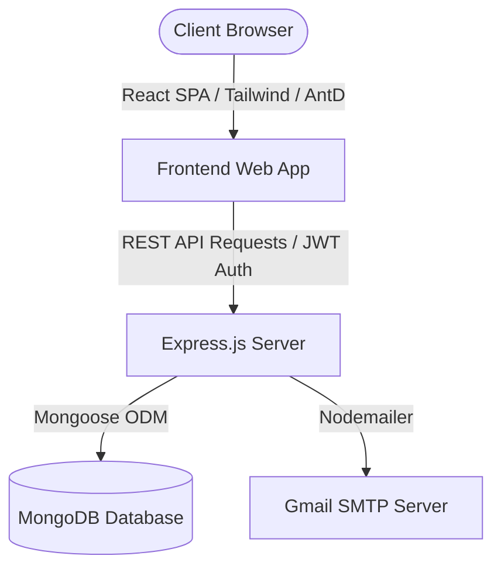

# KHOJ - Full Stack Discovery Platform for Home Services
## Project Report Reference Document

This document contains all the detailed information and technical aspects of the **Khoj** project. You can copy and paste this content directly into Claude to generate your final printed report following your college's specific template.

---

### 1. Student Information
* **Name**: [Your Name]
* **Enrollment / Roll Number**: [Your Roll Number]
* **Semester**: 7th Semester
* **Department**: Computer Science & Engineering (School of Engineering)
* **Allotted Mentor**: [Mentor's Name]

### 2. Internship / UDP / Training Details
* **Type**: User Defined Project (UDP) / Full-Stack Development Training
* **Project Name**: Khoj — Home Service Provider Discovery Platform
* **Allotted Guide**: [Guide's Name]

### 3. Project Title
* **Title**: **Khoj — An Intelligent, High-Performance Discovery and Analytics Platform for Home Service Providers**

### 4. Problem Statement
In developing nations and urban communities, finding verified, skilled, and reliable local service providers (like plumbers, electricians, carpenters, tutors, and cleaners) remains highly fragmented. Customers rely on word-of-mouth or legacy ad-heavy websites that compromise private data and display generic listings without visual feedback. 
On the other side, local independent service providers (merchants) lack a simple, free digital platform to list their skills, show availability, and attract clients. There is a critical need for an ad-free, secure, user-friendly discovery system that visualizes availability charts, filters providers by micro-location (City/State/Category), and manages service profiles safely.

### 5. Objectives
* **Aesthetic User Experience**: Build a premium front-end using Tailwind CSS and Ant Design elements incorporating smooth CSS transitions, interactive hover cards, and a glassmorphism theme to enhance customer trust.
* **Unified Discovery & Search**: Implement multi-level query filters supporting dynamic search by service category, state location, city boundary, and brand name.
* **Service Visualization**: Create real-time chart interfaces displaying service category distributions and density analytics using React Recharts.
* **Secure Auth & Role separation**: Construct a modular authentication route supporting standard users and Merchants (Service Providers) with secure password hashing (Bcrypt) and session validation (JSON Web Tokens).
* **Automated Client Notifications**: Set up nodemailer-driven backend mailers to send automated OTPs and registration confirmations.

### 6. Proposed Methodology
The project is built on the **MERN (MongoDB, Express, React, Node.js)** architecture:
1. **Presentation Layer (Frontend)**: Developed as a Single Page Application (SPA) using React.js. Utilizes Tailwind CSS for advanced visual styling, custom gradients, and glassmorphic modules, and Ant Design for form structures and notification components.
2. **Application Layer (Backend API)**: Created with Node.js and Express.js, featuring helper middlewares (CORS, Morgan logger, Multer for media uploads) and routers to handle RESTful operations.
3. **Data Layer (Database)**: Implemented MongoDB (NoSQL) with Mongoose object modeling to handle records for Users, Categories, States, Cities, and Services.
4. **Authentication Flow**: Uses bcrypt for secure password hashing on register, and issues standard JWT tokens stored securely on login.

### 7. Expected Outcomes
* A fully functional, production-ready discovery application with a modern, high-fidelity responsive user interface.
* Users can filter, search, locate, and read detailed listings of local merchants.
* Merchants can successfully sign up, list services, upload credentials, and customize service descriptions.
* Interactive analytics charts illustrating service densities across states.
* Zero-crash fallback mechanisms for local MongoDB offline environments.

### 8. Future Scope
* **Real-time Chat Integration**: Incorporating WebSockets to allow instant messaging between service seekers and providers.
* **Geolocation Mapping**: Embedding Google Maps or OpenStreetMap APIs to display provider locations dynamically on a map interface.
* **Rating and Review System**: Allowing verified clients to rate providers to foster system accountability.
* **Secure Payment Gateways**: Integrating Razorpay or Stripe to allow transactions directly through the platform.

### 9. Tasks Accomplished
* Formulated the project architecture and initialized the workspace environment.
* Configured core metadata, responsive document headers, web-app manifest descriptors, and structural routes for the platform.
* Built and designed the landing interface layout using premium dark indigo gradients, modern vector SVG icons, Outfit fonts, and glassmorphic user-interface elements.
* Developed dynamic Category Grid modules with custom hover-zoom CSS animations to display services.
* Set up local environment variables (.env) and configuration models (config.js) to support fallback server configurations.
* Verified the client build compilation and successfully ran production compilation builds on local servers.

### 10. Tasks in Progress / Next Plan
* Set up a cloud database instance on MongoDB Atlas.
* Build automated seed scripts to populate mock merchants and services in key regions (plumbers, electricians, cleaners, etc.).
* Prepare deployment configurations for hosting Khoj on Vercel/Render.

### 11. Learnings / Skills Acquired
* Full-stack application architecture (MERN stack).
* Advanced UI design systems using Tailwind CSS, glassmorphism layout modules, and custom typography configurations.
* Component-driven development with Ant Design and state management inside React.
* Environment variable structuring, configuration files, and graceful error boundaries on connection dropouts.
* Git version control and project packaging.

### 12. Gantt Chart Data (Project Schedule)
Below is the timeline mapping for your UDP over the semester:

| Phase | Task Description | Start Week | End Week | Status |
|---|---|---|---|---|
| W1-W2 | Requirement Analysis & Design Mockups | Week 1 | Week 2 | In Progress (Week 1 Completed) |
| W3-W4 | Frontend Base & Layout Redesign (Khoj UI) | Week 3 | Week 4 | Planned / In Progress |
| W5-W6 | Backend API Setup, Schemas & Route Configuration | Week 5 | Week 6 | Planned |
| W7-W8 | Redux State Management & Integration | Week 7 | Week 8 | Planned |
| W9-W10 | Nodemailer OTP & Registration Mailers Implementation | Week 9 | Week 10 | Planned |
| W11-W12| Analytics charts integration (Recharts) | Week 11 | Week 12| Planned |
| W13-W14| System Validation, Production Builds & Report Preparation| Week 13 | Week 14| Planned |

### 13. PERT Chart Analysis (Critical Path Method)
The Project Evaluation and Review Technique (PERT) sequence flow shows the critical path to release **Khoj**:

1. **A: Requirements & Mockups** (Duration: 2 weeks)
2. **B: Core Database Schema Design** (Duration: 1 week) -> *Depends on A*
3. **C: Express.js Backend REST APIs** (Duration: 2 weeks) -> *Depends on B*
4. **D: React Frontend Layout & Glassmorphism Design** (Duration: 2 weeks) -> *Depends on A*
5. **E: API Integration & Global State Management** (Duration: 2 weeks) -> *Depends on C & D*
6. **F: Email Notification & Visual Charts Setup** (Duration: 2 weeks) -> *Depends on E*
7. **G: Build Verification, Testing & Final Documentation** (Duration: 2 weeks) -> *Depends on F*

*Critical Path*: A -> B -> C -> E -> F -> G (Total Minimum Project Duration: 11 weeks).
